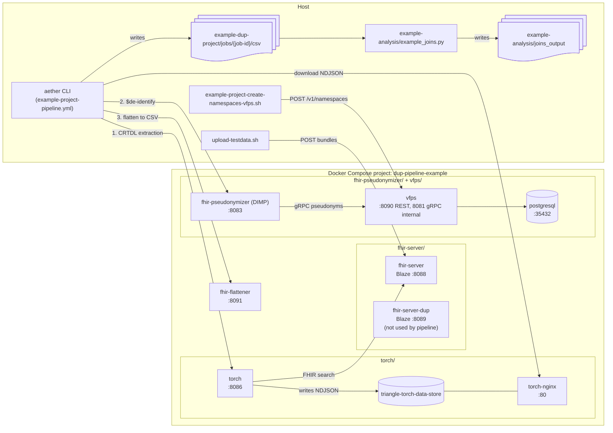

# Architecture

Components started by `start-all.sh` run as Docker containers in one Compose project (`dup-pipeline-example`) and reach each other by service name. Aether, the setup scripts and the analysis script run on the host and reach the containers through the published `localhost` ports.

Pipeline steps enabled in `example-project-pipeline.yml`: `torch`, `dimp`, `flattening`. The `send` and `validation` steps are configured but disabled, so `fhir-server-dup` receives no data.
